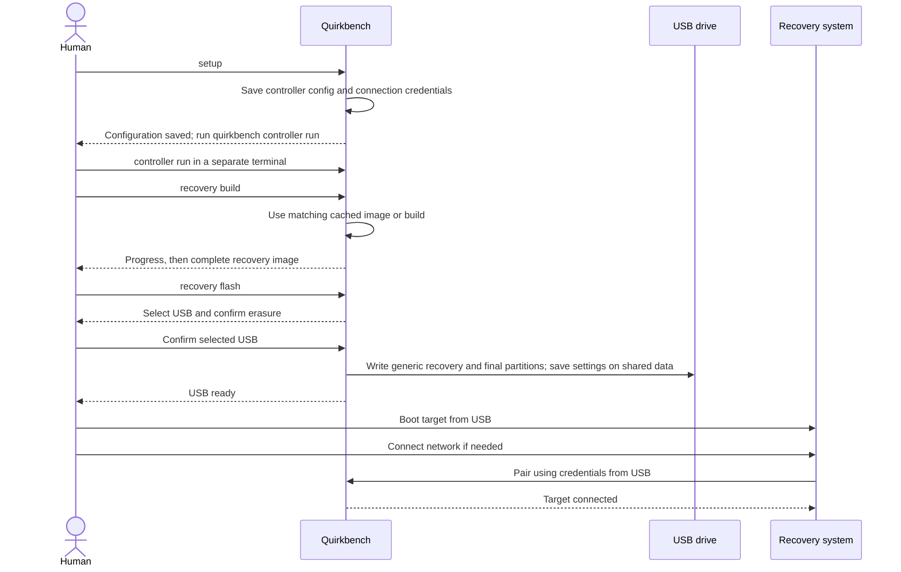
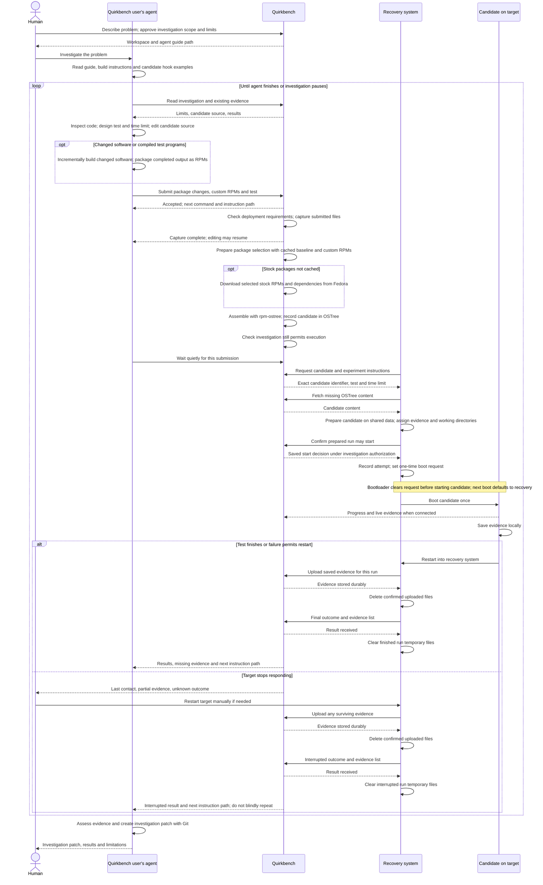
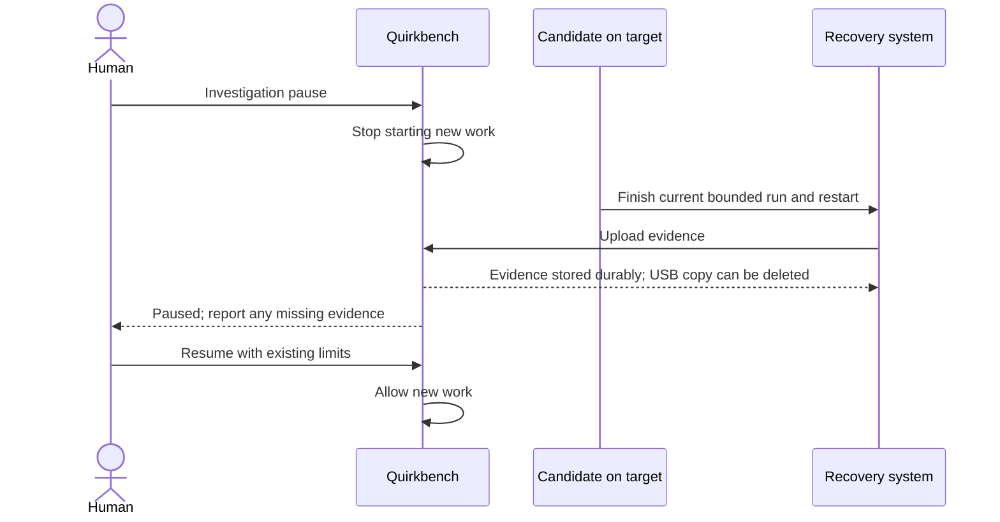

# How the parts work together

Revisable design for the [example walkthrough](../mockups/README.md).
Quirkbench represents the binary and controller together.
Arrows show responsibilities, not new services. Target requests follow the
[controller API](controller-api.md).
Build responsibilities follow the [experiment build design](experiment-builds.md).

## Setup and pairing

## Investigation and experiment loop

Build preparation is shown within Quirkbench, and USB writes within the
system performing them, to keep the diagram focused on the experiment flow.

## Pause and resume

Force stop attempts immediate interruption instead. A frozen target may need a
manual reset. Recovery-system reports use normal pairing for upload; local
collection and preview do not need a connection.
