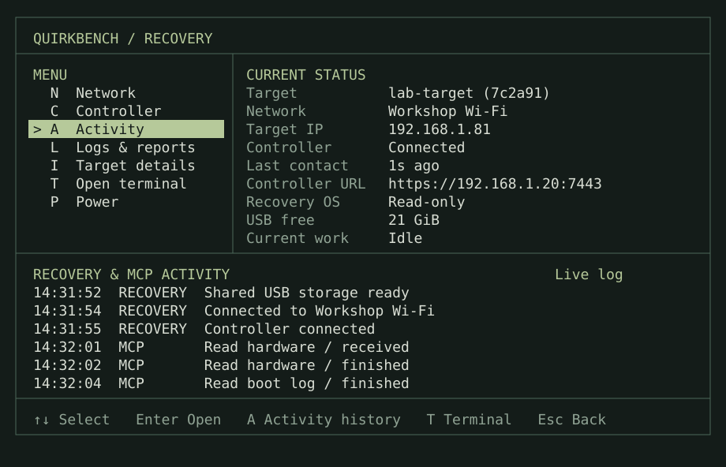

# Recovery console

> **EXAMPLES ONLY — intended design, not the current implementation.** Hardware,
> labels, Wi-Fi, addresses, commands and timings are illustrative. Wired networking
> and any compatible agent are supported. These screens add no product requirements.



## First boot · No network

```text
┌──────────────────────────────────────────────────────────────────────────────┐
│ QUIRKBENCH / RECOVERY                                                        │
├────────────────────────┬─────────────────────────────────────────────────────┤
│ MENU                   │ CURRENT STATUS                                      │
│ > N  Network           │ Target          lab-target (7c2a91)                 │
│   C  Controller        │ Network         Not connected                       │
│   A  Activity          │ Target IP       Not assigned                        │
│   L  Logs & reports    │ Controller      Waiting for network                 │
│   I  Target details    │ Last contact    Never                               │
│   T  Open terminal     │ Controller URL  https://192.168.1.20:7443           │
│   P  Power             │ Recovery OS     Read-only                           │
│                        │ Data free       21 GiB                              │
│                        │ Current work    Idle                                │
├────────────────────────┴─────────────────────────────────────────────────────┤
│ RECOVERY & MCP ACTIVITY                                           Live log   │
│ 14:31:50  RECOVERY  Recovery started                                         │
│ 14:31:52  RECOVERY  Shared USB storage ready                                 │
│ 14:31:54  RECOVERY  No saved network is available                            │
│ 14:31:54  RECOVERY  Waiting for a network connection                         │
│ Next: choose Network to connect this target.                                 │
│                                                                              │
├──────────────────────────────────────────────────────────────────────────────┤
│ [------------] No operation running                                          │
├──────────────────────────────────────────────────────────────────────────────┤
│ ↑↓ Select   Enter Open   A Activity history   T Terminal   Esc Back          │
└──────────────────────────────────────────────────────────────────────────────┘
```

The user chooses Network, connects through NetworkManager and returns.

## Connected · Ready

```text
┌──────────────────────────────────────────────────────────────────────────────┐
│ QUIRKBENCH / RECOVERY                                                        │
├────────────────────────┬─────────────────────────────────────────────────────┤
│ MENU                   │ CURRENT STATUS                                      │
│   N  Network           │ Target          lab-target (7c2a91)                 │
│   C  Controller        │ Network         Workshop Wi-Fi                      │
│ > A  Activity          │ Target IP       192.168.1.81                        │
│   L  Logs & reports    │ Controller      Connected                           │
│   I  Target details    │ Last contact    1s ago                              │
│   T  Open terminal     │ Controller URL  https://192.168.1.20:7443           │
│   P  Power             │ Recovery OS     Read-only                           │
│                        │ Data free       21 GiB                              │
│                        │ Current work    Idle                                │
├────────────────────────┴─────────────────────────────────────────────────────┤
│ RECOVERY & MCP ACTIVITY                                           Live log   │
│ 14:31:52  RECOVERY  Shared USB storage ready                                 │
│ 14:31:54  RECOVERY  Connected to Workshop Wi-Fi                              │
│ 14:31:55  RECOVERY  Controller connected                                     │
│ 14:32:01  MCP       Read hardware / received                                 │
│ 14:32:02  MCP       Read hardware / finished                                 │
│ 14:32:04  MCP       Read boot log / finished                                 │
├──────────────────────────────────────────────────────────────────────────────┤
│ [------------] No operation running                                          │
├──────────────────────────────────────────────────────────────────────────────┤
│ ↑↓ Select   Enter Open   A Activity history   T Terminal   Esc Back          │
└──────────────────────────────────────────────────────────────────────────────┘
```

## Agent preparing a candidate

```text
┌──────────────────────────────────────────────────────────────────────────────┐
│ QUIRKBENCH / RECOVERY                                                        │
├────────────────────────┬─────────────────────────────────────────────────────┤
│ MENU                   │ CURRENT STATUS                                      │
│   N  Network           │ Target          lab-target (7c2a91)                 │
│   C  Controller        │ Network         Workshop Wi-Fi                      │
│ > A  Activity          │ Target IP       192.168.1.81                        │
│   L  Logs & reports    │ Controller      Connected                           │
│   I  Target details    │ Last contact    1s ago                              │
│   T  Open terminal     │ Controller URL  https://192.168.1.20:7443           │
│   P  Power             │ Recovery OS     Read-only                           │
│                        │ Data free       21 GiB                              │
│                        │ Current work    Downloading candidate               │
├────────────────────────┴─────────────────────────────────────────────────────┤
│ RECOVERY & MCP ACTIVITY                                           Live log   │
│ 14:34:52  MCP       Read storage / finished                                  │
│ 14:35:08  MCP       Deploy baseline-1 / received                             │
│ 14:35:09  RECOVERY  Downloading candidate content                            │
│ 14:36:20  RECOVERY  Download active / last update 1s ago                     │
│ Next: prepare run files; wait for a boot request.                            │
├──────────────────────────────────────────────────────────────────────────────┤
│ [---###------] Downloading candidate / 72s                                   │
├──────────────────────────────────────────────────────────────────────────────┤
│ ↑↓ Select   Enter Open   A Activity history   T Terminal   Esc Back          │
└──────────────────────────────────────────────────────────────────────────────┘
```

The user chooses Activity, then the running action.

```text
  ACTIVITY / Deploy baseline-1

  Running · Downloading candidate content
  Started 14:35:08 · Elapsed 1m 12s · Last update 1s ago
  Investigation first-boot · Request send-1
  MCP tool recovery_deploy_ostree

  Received    640 MiB / 1.2 GiB
  Next        Prepare run files, then wait for a boot request

  Recent output
  Downloading candidate content from the controller...

  ↑↓ Scroll   F Follow output   Esc Back
```

## Controller connection lost

```text
┌──────────────────────────────────────────────────────────────────────────────┐
│ QUIRKBENCH / RECOVERY                                                        │
├────────────────────────┬─────────────────────────────────────────────────────┤
│ MENU                   │ CURRENT STATUS                                      │
│   N  Network           │ Target          lab-target (7c2a91)                 │
│ > C  Controller        │ Network         Workshop Wi-Fi                      │
│   A  Activity          │ Target IP       192.168.1.81                        │
│   L  Logs & reports    │ Controller      Disconnected                        │
│   I  Target details    │ Last contact    42s ago                             │
│   T  Open terminal     │ Controller URL  https://192.168.1.20:7443           │
│   P  Power             │ Recovery OS     Read-only                           │
│                        │ Data free       21 GiB                              │
│                        │ Current work    Reconnecting; upload waiting        │
├────────────────────────┴─────────────────────────────────────────────────────┤
│ RECOVERY & MCP ACTIVITY                                           Live log   │
│ 14:31:02  RECOVERY  Returned from candidate run 3                            │
│ 14:31:02  RECOVERY  Candidate connection timed out                           │
│ 14:31:05  RECOVERY  Uploading saved run logs                                 │
│ 14:32:01  RECOVERY  Controller connection lost                               │
│ 14:32:01  RECOVERY  Unconfirmed evidence kept on USB                         │
│ 14:32:43  RECOVERY  Reconnecting / no commands running                       │
├──────────────────────────────────────────────────────────────────────────────┤
│ [------------] No operation running                                          │
├──────────────────────────────────────────────────────────────────────────────┤
│ ↑↓ Select   Enter Open   A Activity history   T Terminal   Esc Back          │
└──────────────────────────────────────────────────────────────────────────────┘
```

## Logs & reports

```text
  LOGS & REPORTS / lab-target

  > View boot logs
    View Quirkbench service logs
    Preview Quirkbench internal debugging report
    Save report
    Send report to controller

  Enter Open   Esc Back   T Terminal
```

## Target details

```text
  TARGET DETAILS

  Label          lab-target
  Model          ASUS Chromebook
  Target         7c2a91  [Show full ID]
  Recovery       recovery-1
  Booted         6 minutes ago
  Data           21 GiB free / 27 GiB usable

  Use lab-target when selecting this target on the controller.

  Esc Back
```

## Power

```text
  POWER

    Back
    Reboot
  > Shut down

  Enter Select   Esc Back
```

```text
  SHUTTING DOWN

  Stopping target work

  Wait until the computer has powered off before disconnecting the drive.

  If this takes too long, press T to open the terminal.

  --------------------------------------------------------------------------
  [---###------] Stopping target work / 3s
  T Open terminal
```

If work is running, selecting Reboot asks for confirmation first.

```text
  CONFIRM

  Current work: Downloading candidate
  This interrupts active work. Unconfirmed evidence stays on the drive.

  > Cancel
    Reboot now

  Enter Select   Esc Back
```

```text
  POWER ACTION FAILED

  Cannot write boot settings

  Press Esc to return and retry, or T to inspect the problem in a terminal.

  Esc Back   T Open terminal
```

```text
POWER

  Back
  Reboot
  Shut down
  Force reboot
> Force power off
```

```text
EMERGENCY POWER

Unsaved data may be lost. This skips shutdown and storage cleanup.
Force reboot cannot change the next boot selection.
If the kernel cannot respond, use the physical power button.

> Cancel
  Force power off now
```

```text
SHUTTING DOWN

Stopping target work

F Force power action   T Open terminal
```

```text
LOGS & REPORTS

  View boot logs
  View Quirkbench service logs
  Preview report
  Save report
  Send report to controller
> Send emergency report

Report uploaded. Local copy: /run/quirkbench-runtime/reports/recovery-184.txt
```

## Before the recovery menu · Boot troubleshooting

```text
Quirkbench recovery
Troubleshoot recovery (early boot shell)
```

```console
At the shell, run quirkbench-boot-report. Type exit to continue booting.
dracut:/# quirkbench-boot-report

Quirkbench early boot report

Boot options:
...
Memory:
...
Detected disks and partitions:
...
Filesystem identifiers:
...
USB4 / Thunderbolt connection state:
/sys/bus/thunderbolt/devices/0-1
  device_name: External storage
  authorized: 1
...
Recent kernel messages:
...
Full boot log: /run/initramfs/rdsosreport.txt (when generated by dracut)
dracut:/# exit
```

## Moving the drive (illustrative)

```text
First computer
  Target          Workshop desktop (34c921)
  Controller      Connected
  Current work    No operation running

Move the recovery drive to another computer and boot recovery.

Second computer
  Target          Example Workstation (8d102a)
  Network         Lab Wi-Fi
  Controller      Connected
  Current work    No operation running

Return the drive to the first computer and boot recovery.

First computer
  Target          Workshop desktop (34c921)
  Controller      Connected
  Current work    Uploading evidence
```
